<p align="center">
  
</p>

<p align="center">
  <a href="https://github.com/ishandutta2007/Awesome-Awesome-Awesome"></a>
  <a href="https://discord.gg/jc4xtF58Ve"></a>
  <a href="LICENSE"></a>
  <a href="https://github.com/ishandutta2007/Awesome-Youtube-Virtual-Production/stargazers"></a>
  <a href="https://github.com/ishandutta2007/Awesome-Youtube-Virtual-Production/network/members"></a>
  <a href="https://github.com/ishandutta2007/Awesome-Youtube-Virtual-Production/pulls"></a>
  <a href="https://github.com/ishandutta2007"></a>
</p>

---

# 🎬 Awesome YouTube Virtual Production 🎥

> **A comprehensive, SEO-optimized, community-curated directory of premier SaaS platforms, commercial virtual studio systems, and open-source GitHub projects for YouTube Virtual Production, Real-Time Rendering, In-Camera VFX (ICVFX), LED Volume Stages, and Camera Tracking.**

Whether you are a solo YouTuber setting up a dynamic broadcast studio, an indie filmmaker building affordable LED/green-screen virtual sets, or a real-time developer integrating tracking protocols (Free-D, OpenTrackIO), this repository provides the complete software stack and market intelligence for modern real-time visual storytelling.

---

## 📑 Table of Contents

- [🔍 SEO &amp; Topic Highlights](#-seo--topic-highlights)
- [📊 Sector Overview &amp; Market Dynamics](#-sector-overview--market-dynamics)
- [🏢 SaaS &amp; Commercial Virtual Studio Platforms](#-saas--commercial-virtual-studio-platforms)
- [💻 Open-Source Virtual Production Ecosystem](#-open-source-virtual-production-ecosystem)
- [🛠️ Recommended Architecture for YouTube Studios](#️-recommended-architecture-for-youtube-studios)
- [📈 Star History](#-star-history)
- [💖 Support &amp; Community](#-support--community)
- [🤝 How to Contribute](#-how-to-contribute)
- [⚖️ Disclaimer](#️-disclaimer)

---

## 🔍 SEO & Topic Highlights

- **Domain Keywords:** Virtual Production, YouTube Studio Setup, In-Camera VFX (ICVFX), LED Wall Volume, Real-Time Rendering, Unreal Engine 5, Aximmetry, Zero Density, disguise Designer, Mo-Sys, Vizrt TriCaster, StypeLand.
- **Protocols & Integrations:** Free-D Protocol, OpenTrackIO, NDI (Network Device Interface), Spout2 / Syphon, OpenColorIO (OCIO), Live Link, WebXR, DaVinci Resolve OFX.
- **Hardware & Workflows:** PTZ Camera Tracking, HTC Vive Mars CamTrack, Mo-Sys StarTracker, Green Screen Chroma Keying, Microdrama Previs, AI Virtual Cinematography.

---

## 📊 Sector Overview & Market Dynamics

The global **Virtual Production** market is valued at approximately **$3.8B to $4.4B in 2026** and is projected to expand past **$12B by 2030+**, compounding at an extraordinary **20% to 33% CAGR**. Growth is heavily accelerated by content creators, broadcast streaming houses, and commercial studios adopting game engines and in-camera VFX (ICVFX) to slash physical set costs, eliminate lengthy post-production cycles, and achieve broadcast-quality realism on creator budgets.

The sector demonstrates a **bifurcated market structure**:
1. **Foundational Engine Concentration (Winner-Take-Most):** The core real-time 3D rendering foundation is heavily concentrated around **Epic Games' Unreal Engine**, which serves as the undisputed industry standard across broadcast virtual studios, LED stages, and indie pipelines.
2. **Specialized Studio & Tooling Fragmentation:** Outside the foundational engine layer, the market is **moderately to highly fragmented**. Specialized broadcast graphics vendors (Vizrt, Ross Video), XR media server specialists (disguise), camera tracking pioneers (Mo-Sys, Stype), virtual set compilers (Aximmetry, Zero Density), and an expanding wave of agile open-source projects actively compete to capture distinct creator tiers and budget niches.

---

## 🏢 SaaS & Commercial Virtual Studio Platforms

The table below lists leading commercial virtual production suites, sorted in **descending order by company size (valuation and annual revenue)**. All pricing tiers and free trial/forever conditions reflect verified specific entry plans:

| 🏷️ Product &amp; Link | 📝 Description &amp; Core Capabilities | 💰 Company Size (Valuation / Revenue) | 💳 Starting Tier Pricing | 🎁 Free Tier Limits &amp; Trial Conditions |
| :--- | :--- | :--- | :--- | :--- |
| **[Unreal Engine](https://www.unrealengine.com/)** | Industry-standard real-time 3D creation engine for ICVFX, nDisplay LED volumes, virtual cameras, and live broadcast compositing. | **$22.5B Valuation**<br>*(~$5.74B Annual Revenue)* | **$1,850 / seat / year**<br>*(Commercial seat license for enterprise linear broadcast/film with &gt;$1M annual revenue)* | **Free forever** for creators, students, and studios earning under **$1,000,000 USD** in annual gross revenue; includes unrestricted access to full engine, nDisplay, and complete source code. |
| **[Vizrt](https://www.vizrt.com/)** | Broadcast graphics and live virtual studio ecosystem powered by Viz Engine, TriCaster, and Viz Virtual Studio automation. | **~$1.5B Valuation**<br>*(~€145M / $155M Annual Revenue)* | **$65 / month**<br>*(TriCaster Now cloud discovery starter pass; TriCaster Mini S software starts at $2,499 perpetual)* | **29-day fully functional free trial** for TriCaster Mini S software; **60-day learner license** for Viz Artist &amp; Viz Engine with free forever access for non-commercial educational study. |
| **[Ross Video](https://www.rossvideo.com/)** | Enterprise broadcast infrastructure featuring Voyager real-time Unreal Engine graphics renderers, UX control, and robotic tracking. | **~$1.3B Valuation**<br>*(~$350M–$420M Annual Revenue)* | **$41,000+ one-time**<br>*(Voyager core Unreal Engine render software license; turnkey systems vary by I/O)* | **0-day public trial** *(No self-service free download)*; custom interactive proof-of-concept evaluation and live workflow demonstrations provided upon enterprise sales qualification. |
| **[disguise](https://www.disguise.one/)** | Premier XR production platform, media servers, and Designer software for LED volume mapping, projection, and live stage control. | **~$300M+ Valuation**<br>*(~$60M Annual Revenue)* | **$159 / month**<br>*(or $1,500/year billed annually for Designer Pro software license)* | **Free forever** via **Designer Starter** edition; unlimited duration for offline pre-visualization, stage design, and timeline programming (outputs watermarked, live video hardware I/O disabled). |
| **[Zero Density](https://zerodensity.tv/)** | Photorealistic virtual studio and AR platform featuring Reality5 (Unreal Engine 5 integration) and Traxis tracking ecosystem. | **~$25M+ Valuation**<br>*(~$10M–$14M Annual Revenue)* | **$4,888 / year**<br>*(Reality 5 On-Air Graphics bundle; Designer bundle starts at $8,067/year)* | **Free forever** under **Open Studio License Program (OSLP)** for independent creators and SOHO teams earning &lt;$1M/year (watermarked for non-commercial learning, full Reality5 + Reality Hub LE). |
| **[Mo-Sys Engineering](https://www.mo-sys.com/)** | Virtual production camera tracking pioneer with VP Pro, StarTracker optical tracking, and open-source telemetry protocols. | **~$20M Valuation**<br>*(~$13M–$25M Annual Revenue)* | **$3,150 / year**<br>*(~£2,450/year for VP Pro virtual production toolkit license per camera)* | **30-day evaluation trial license** available upon application; the core **OpenTrackIO** SMPTE-standard camera tracking C++ protocol library is free and open-source forever. |
| **[Pixotope](https://pixotope.com/)** | Live virtual production software suite offering real-time camera tracking, talent tracking, AR graphics, and XR stage extensions. | **~$20M Valuation**<br>*(~$9.8M Annual Revenue)* | **$2,500 / month**<br>*(Baseline software subscription per camera channel, or ~$9,900/year Pixotope Graphics)* | **0-day public trial** *(No open self-service download)*; comprehensive tailored live demonstration and temporary proof-of-concept testing environments arranged via technical sales. |
| **[Brainstorm 3D](https://www.brainstorm3d.com/)** | Real-time 3D graphics, virtual sets, and presenter XR solutions featuring InfinitySet and Edison PRO creator workstations. | **~$15M Valuation**<br>*(~$10M Annual Revenue)* | **$9,995 one-time**<br>*(Edison PRO turnkey all-in-one virtual studio presentation software/workstation package)* | **30-day evaluation trial license** provided to qualified broadcast operators, educational institutions, and corporate studios upon direct registration and technical review. |
| **[Stype](https://stype.tv/)** | Camera and object tracking specialist providing RedSpy optical tracking, Follower automation, and StypeLand Unreal Engine plugins. | **~$15M Valuation**<br>*(~$10M–$12M Annual Revenue)* | **$3,000 / year**<br>*(StypeLand XR Unreal Engine plugin software license; physical security USB dongle ~$100)* | **30-day non-commercial watermarked trial license** for StypeLand plugin evaluation and testing in Unreal Engine environments prior to live deployment. |
| **[Aximmetry](https://aximmetry.com/)** | Accessible virtual studio and chroma keying platform integrating real-time camera tracking, NDI/SDI I/O, and Unreal Engine pipelines. | **~$12M–$15M Valuation**<br>*(~$3.3M Annual Revenue)* | **$199 / month**<br>*(Aximmetry Studio Edition monthly rental/subscription)* | **Free forever** with **Studio Limited Edition**; watermark applied to outputs, limited to 1 NDI input/output stream and basic camera tracking (no native Unreal Engine interactive rendering). |

---

## 💻 Open-Source Virtual Production Ecosystem

Open-source virtual production tooling empowers YouTubers, independent filmmakers, and hackers to build transparent, customizable, and budget-friendly real-time sets. 

The repositories below are **strictly sorted in descending order by GitHub Star counts** and include live social star badges linking directly to each project's stargazers:

1. **[CozyClay](https://github.com/NomaDamas/CozyClay)** [](https://github.com/NomaDamas/CozyClay/stargazers)  
   *Open-source previs in the browser.* Block 3D scenes, pose digital avatars, choreograph camera tracks, cut shot sequences, and feed camera parameters directly to generative AI video pipelines.

2. **[CorridorKey Runtime](https://github.com/alexandremendoncaalvaro/CorridorKey-Runtime)** [](https://github.com/alexandremendoncaalvaro/CorridorKey-Runtime/stargazers)  
   *Native AI chroma keying runtime &amp; OFX plugin for DaVinci Resolve.* Developed in collaboration with Corridor Digital to deliver clean hair extraction, edge despill, and background matting for indie virtual sets.

3. **[UnityChromakey](https://github.com/otdavies/UnityChromakey)** [](https://github.com/otdavies/UnityChromakey/stargazers)  
   *GPU-accelerated green-screen and chroma keying solution for Unity.* Engineered for real-time virtual production, live broadcasts, and mixed reality streaming with edge feathering and despill passes.

4. **[awplanet](https://github.com/awplanets/awplanet)** [](https://github.com/awplanets/awplanet/stargazers)  
   *AI-native 3D director workbench and virtual production studio.* Built with React, Three.js, and Electron. Features skeletal posing, cinematic camera controls, storyboard timelines, and mobile phone virtual camera piloting.

5. **[Polychase](https://github.com/theartful/polychase)** [](https://github.com/theartful/polychase/stargazers)  
   *Blender motion tracking addon inspired by KeenTools GeoTracker.* Tracks camera movement and geometry in video footage using optical flow and PnP algorithms with real-time 3D pin alignment.

6. **[LabCamera](https://github.com/meshula/LabCamera)** [](https://github.com/meshula/LabCamera/stargazers)  
   *Physically-based camera model for virtual cinematography.* Accurately simulates realistic physical lenses, sensor dimensions, chromatic aberration, and depth of field in virtual environments.

7. **[VPET (Virtual Production Editing Tools)](https://github.com/FilmakademieRnd/VPET)** [](https://github.com/FilmakademieRnd/VPET/stargazers)  
   *Tablet-based on-set virtual production editor by Filmakademie R&amp;D.* Enables directors, cinematographers, and gaffers to interactively manipulate 3D set assets, lighting rigs, and camera parameters during live shooting.

8. **[godot-ndi](https://github.com/unvermuthet/godot-ndi)** [](https://github.com/unvermuthet/godot-ndi/stargazers)  
   *NDI® integration for Godot Engine.* Allows sending and receiving ultra-low-latency video frames over standard local networks, powering lightweight open-source virtual sets and broadcast motion graphics.

9. **[UE5_Spout2_DX12](https://github.com/GPUbrainStorm/UE5_Spout2_DX12)** [](https://github.com/GPUbrainStorm/UE5_Spout2_DX12/stargazers)  
   *DirectX 12 Spout2 plugin for Unreal Engine 5.* Facilitates zero-copy GPU memory sharing of real-time render buffers between UE5, OBS Studio, TouchDesigner, Resolume, and Notch for YouTube livestreams.

10. **[Glass Engine](https://github.com/Time-Coder/Glass-Engine)** [](https://github.com/Time-Coder/Glass-Engine/stargazers)  
    *Python-native 3D real-time rendering engine.* Embeds interactive 3D viewports inside PySide6/PyQt5 GUI tools with PBR lighting, deferred shading, bloom, and depth-of-field for bespoke virtual production tools.

11. **[smartphoneremote_ue5](https://github.com/renamedquery/smartphoneremote_ue5)** [](https://github.com/renamedquery/smartphoneremote_ue5/stargazers)  
    *Mobile virtual camera controller for Unreal Engine 5.* Uses smartphone sensors (gyroscope, accelerometer) to stream 6-DOF camera tracking telemetry into UE5 cine-cameras via Wi-Fi.

12. **[OWL Virtual Production](https://github.com/Off-World-Live-Collaborative/OWLVirtualProduction)** [](https://github.com/Off-World-Live-Collaborative/OWLVirtualProduction/stargazers)  
    *Off World Live virtual production reference project.* Demonstrates 360/panoramic streaming, Spout camera output, live compositing, and NDI pipelines within Unreal Engine.

13. **[gl-chromakey](https://github.com/bhj/gl-chromakey)** [](https://github.com/bhj/gl-chromakey/stargazers)  
    *Real-time GPU-accelerated WebGL chroma keying.* Strips green-screen backgrounds from live HTML5 video elements, webcams, and canvases directly inside browser-based studio apps.

14. **[DogHut-VirtualCamera_forUE4](https://github.com/doghutVP/DogHut-VirtualCamera_forUE4)** [](https://github.com/doghutVP/DogHut-VirtualCamera_forUE4/stargazers)  
    *Virtual camera system for real-time filmmaking.* Features lens presets, focus-pulling workflows, and Live Link motion tracking for Unreal Engine virtual stages.

15. **[AI Virtual Director Studio](https://github.com/femnn/ai-virtual-director-studio)** [](https://github.com/femnn/ai-virtual-director-studio/stargazers)  
    *Local-first AI virtual cinematography studio.* Build 3D sets via JSON commands, synchronize multiple smartphone virtual cameras, capture facial performances with FaceCap, and record live camera feeds directly to MP4.

16. **[OpenHUTB Engine](https://github.com/OpenHUTB/engine)** [](https://github.com/OpenHUTB/engine/stargazers)  
    *AAA simulation and cinematic rendering engine.* Employs PhysX, DDGI, and hardware ray tracing with deterministic frame-time budgets tailored for film and virtual studio pipelines.

17. **[OpenTrackIO C++](https://github.com/mosys/opentrackio-cpp)** [](https://github.com/mosys/opentrackio-cpp/stargazers)  
    *Open-source C++ implementation of the SMPTE OpenTrackIO protocol.* Spearheaded by Mo-Sys and adopted by Epic Games; standardizes camera position, rotation, lens focus, zoom, and distortion data for ICVFX.

18. **[Phi Engine](https://github.com/float64co/Phi)** [](https://github.com/float64co/Phi/stargazers)  
    *MicroPython-powered game engine inspired by UE5 and Blender.* Features deferred rendering, temporal anti-aliasing (TAA), Bullet physics, and live in-editor scene manipulation.

19. **[rust-FreeD](https://github.com/ssav7912/rust-FreeD)** [](https://github.com/ssav7912/rust-FreeD/stargazers)  
    *Modern Rust implementation of the Free-D camera tracking protocol.* High-efficiency decoding and serialization of UDP tracking packets for robotics and virtual camera heads.

20. **[Red Clover Studio](https://github.com/ShawnTheWriter/red-clover-studio)** [](https://github.com/ShawnTheWriter/red-clover-studio/stargazers)  
    *Local-first AI film and microdrama production studio.* Parses scripts into storyboards, animates shots, and synchronizes round-trip edits into DaVinci Resolve.

21. **[FreeD4j](https://github.com/spannercodes/FreeD4j)** [](https://github.com/spannercodes/FreeD4j/stargazers)  
    *Java library for Free-D camera telemetry.* Parses and validates UDP camera position and orientation packets for broadcast studio switchers and network bridges.

22. **[chroma_key](https://github.com/anphiriel/chroma_key)** [](https://github.com/anphiriel/chroma_key/stargazers)  
    *Python &amp; OpenCV real-time chroma key compositor.* Features edge feathering, partial alpha blending, and green color cast suppression for lightweight background replacement.

---

## 🛠️ Recommended Architecture for YouTube Studios

```
  ┌────────────────────────┐         ┌────────────────────────┐
  │  🎥 Camera & Sensors   │         │  📱 Smartphone Tracker │
  │  (PTZ / Vive Mars /    │         │  (smartphoneremote_ue5 │
  │   StarTracker / FreeD) │         │   or awplanet director)│
  └───────────┬────────────┘         └───────────┬────────────┘
              │                                  │
              │ Telemetry (Free-D / OpenTrackIO) │
              ▼                                  ▼
      ┌──────────────────────────────────────────────────┐
      │          🎮 Real-Time 3D Engine Layer             │
      │  (Unreal Engine 5 / Aximmetry / Godot / Unity)   │
      │  • In-Camera VFX & Parallax Background Rendering │
      │  • Dynamic Virtual Lighting & Shadows            │
      └───────────────────────┬──────────────────────────┘
                              │
              GPU Texture Sharing (Spout2 / NDI)
                              ▼
      ┌──────────────────────────────────────────────────┐
      │       🎬 Live Compositing & Switching Layer      │
      │  (OBS Studio / DaVinci Resolve / CorridorKey)     │
      │  • Ultra-Clean AI Chroma Keying & Despill        │
      │  • Color Grading via OpenColorIO (OCIO)          │
      └───────────────────────┬──────────────────────────┘
                              │
                              ▼
                   🔴 Live Stream to YouTube
                   💾 High-Bitrate Master Recording
```

---

## 📈 Star History

[](https://star-history.dera.page/#ishandutta2007/Awesome-Youtube-Virtual-Production&type=date&legend=top-left)

---

## 💖 Support & Community

Thank you for exploring and utilizing **Awesome-Youtube-Virtual-Production**! If this curated ecosystem directory accelerates your studio setup or development:

- ⭐ **Star this repository** to improve discoverability for creators worldwide!
- 🍴 **Fork the project** and submit pull requests with newly released tools and libraries.
- 📢 **Share with fellow YouTubers**, indie filmmakers, and real-time VFX artists.
- ☕ **Sponsor & Buy Me a Coffee**: Support ongoing maintenance and curation on the [GitHub Sponsor Dashboard](https://github.com/sponsors/ishandutta2007).

---

## 🤝 How to Contribute

1. Fork this repository to your GitHub account.
2. Add or update tool entries in `README.md` following the established table or list format.
3. For SaaS products: provide verified specific pricing and explicit free tier/trial limits.
4. For open-source repos: include the live social star badge linking to its `/stargazers` URL.
5. Submit a pull request with a clear description of the project.

---

## ⚖️ Disclaimer

- This is a community-curated educational resource; inclusion does not constitute a commercial endorsement.
- All trademarks, logos, and brand names belong to their respective owners.
- Virtual production pipelines must adhere to respective software licensing terms and broadcast broadcast regulations.

---

<p align="center">
  <b>Built with ❤️ for indie filmmakers, YouTube creators, and real-time VFX developers.</b>
</p>
